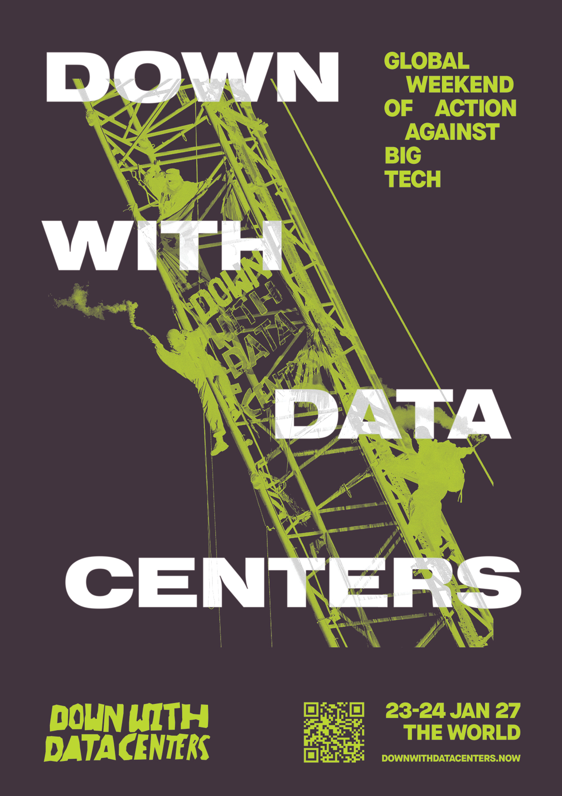
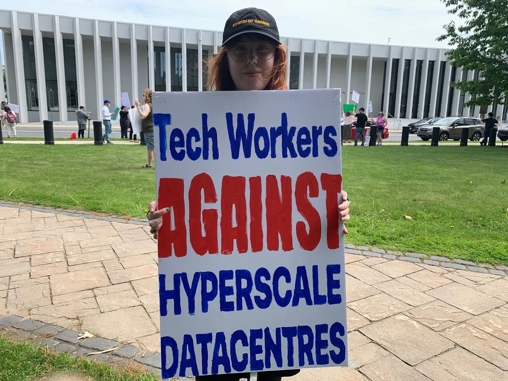

Tech Workers are spearheading the global initiative Down with Data Centers, a weekend of action against Big Tech that will take place on the 23rd and 24th of January.

The initiative is a big tent designed to show the world how much the forceful and rushed deployment of technologies nobody asked for is despised by communities, workers, and citizens. Hyperscalers data centers are the symptom, and as tech workers, we know the wasteful expense of electricity, water, land, and the disrespect towards local communities are not technical problems. They are embedded in the very logic of the industry, because it’s the same logic applied to our own well-being in the workplace. The careless and abusive way companies build data centers embodies the same attitude they push on us to build what we work on: cutting corners, disregarding laws, and ignoring the people impacted.

Hyperscalers and the surplus of “cheap” computation they provide do not benefit workers. They do not benefit those who live next to them. They do not benefit the victims of military aggression orchestrated through the increasingly automated kill chains. They do not benefit the environment, and they are for sure not necessary to run imaging software to detect cancer. They do not benefit the netizens, who are being flooded with endless waves of slop. They do not benefit the surveilled activists and organizers, targeted by state repression.

The world, in the last few years, has been waking up to the relevance of technology for politics, society, and individual and collective well-being. We have known this for a while, because we are at the front lines where these technologies are conceived, designed, and implemented. We see the trends before others, because many of us sit in the same rooms with the people who want or enable the technological system we live in.

Imagine if your coked-out boss who can’t edit an Excel file had the power to influence the economic policies around technology for half of the world, or advise top politicians on how to put LLMs in a system that controls nuclear warheads. Well, it happened to some of us.

It is no surprise, then, that tech workers are at the forefront of such an initiative. Tech Workers Coalition (TWC), WhatWeWill (WWW), United Tech and Allied Workers (UTAW), and Computer Professional Union (CPU) are just some of the unions and tech workers’ collectives actively preparing actions.

Down with Data Centers is just a weekend of action. It will create relationships. It will mobilize people, and some of them will stay active throughout. Protest alone doesn’t change things, though. Every organization joins the initiative from a different strategic position and hopes to benefit from this concerted effort.

For tech workers specifically, though, this represents a special occasion. While international organizing is understood as a necessity since the tech industry is far-reaching, the concrete chances to put this consensus into practice. Sure, there have been coordinated strikes or protests in specific companies across countries, but these efforts could only involve tech unions, and only the ones already active in those companies.

This time it is different: the frame of Down with Data Centers allows local initiatives and different types of organizations to apply political pressure to different points of leverage, depending on their context. Therefore, different types of tech unions, tech workers’ collectives, and movements involving a large number of tech workers can finally present themselves on the stage of global politics as a relevant, coherent political actor.

A timely occasion, fit to overcome the now stale narrative that tech workers taking a political stance or organizing in the workplace are exceptional, novel, and curious happenings. Now that technology is at the center of politics, politics should become a central aspect of tech workers’ identity.

Big Tech has openly declared war on the World’s working class through the deployment of their “AI” project, betting on the permanent destruction of the power of cognitive labor. It is no surprise that it’s much easier, for organizations involving workers in wildly different conditions, to find International alignment and commonality today, on political grounds.

Having a common enemy helps, but resisting it is not the end goal. Citizens, workers, institutions, and governments are going through a precipitous loss of trust towards American Big Tech on a global scale. The actors that gained prominence by supposedly opposing the interests of tech oligarchs are struggling to keep their formula convincing: the NGO-industrial complex, the Effective Altruism’s “AI Safety” movement, and the European regulatory bodies have failed at limiting the harm of Big Tech, let alone steering technological development in service of society.

Once the whole “AI” project collapses on itself, people will be looking for better answers, for a new way to conceive and produce technology. A way that is democratic, accountable to the interests of society and workers. A way that serves life. As tech workers, we need to be ready to present ourselves as such an alternative. We are depositories of knowledge, and we care about how technology is built, where bosses do not.

Now it’s time to show we also care about what technology is built for and for what purposes.

The event keeps growing day by day. If you want to join, fill out the form you can find on the website: <https://downwithdatacenters.now/>

See you on the 23rd/24th!
